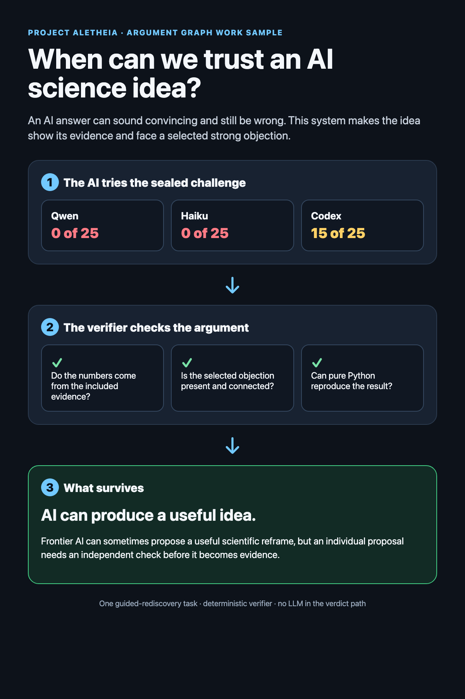

# Aletheia Argument Graph Demo

This is a small, runnable work sample for CARMA's AI Safety Argumentation Platform Research Engineer role.

It answers one plain question:

> When should I trust an AI-generated scientific idea?

Three AI systems tried the same sealed guided-rediscovery task. Qwen scored 0 of 25, Haiku scored 0 of 25, and Codex scored 15 of 25. The graph keeps both sides visible: AI showed useful capability, and no individual proposal became evidence without an independent check.



## Run it

Only Python 3.11 or newer is required.

```bash
python3 run_demo.py
```

Then open `build/index.html`.

Run the verifier tests:

```bash
python3 -m unittest discover -s tests -v
```

## What the program does

1. Verifies the hashes of the included evidence extracts.
2. Re-extracts every displayed model score.
3. Builds typed nodes for claims, evidence, assumptions, objections, rebuttals, and uncertainty.
4. Rejects broken provenance, invalid connections, missing objections, confidence changes, and claims above the frozen boundary.
5. Computes Dung grounded semantics over the node-attack graph, then reports direct evidential support separately.

The verdict path uses standard-library Python. It does not call an LLM, network service, or subprocess.

## Why it exists

CARMA's role asks for claim and evidence schemas, defeasible arguments, knowledge graphs, LLM quality control, provenance, counterarguments, and reliable agent boundaries. This repository demonstrates a small working slice of that problem.

The code lets an LLM suggest future entries, but a model-authored suggestion cannot promote itself into evidence.

## Honest boundary

- This is one guided-rediscovery task, not a general AI-discovery benchmark.
- The included JSON files are sanitized extracts. Their original artifact hashes remain attached, but the private full reports are not published here.
- A human selected the objection shown in the graph. The program checks that the selected objection exists and attacks the claim.
- The formal result covers the stated graph. It does not establish scientific truth or source completeness.
- The broad-claim detector is a tripwire over named phrases. Human review still owns semantic scope.
- This implements a bounded Dung projection. It does not claim full ASPIC+ support or official CARMA compatibility.

## Repository map

```text
data/evidence/                  sanitized frozen evidence
data/source_manifest.json      hash bindings
src/aletheia_argument_graph/   adapter, verifier, semantics, renderer
tests/test_demo.py              counterfactual and reproducibility tests
docs/                           GitHub Pages-ready visual
build/                          generated local output
```

## Result

The current case returns `ACCEPT`. The bounded claim is dialectically accepted and has accepted direct evidence. The selected capability objection is rejected after the rebuttal and candidate encoding warning are applied.

The test suite also proves that a self-consistent doctored score cannot pass merely by updating its file hash.

## License

MIT. The evidence extracts retain their provenance boundary and should not be mistaken for the private full reports.
